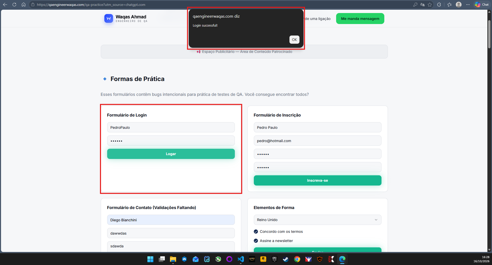
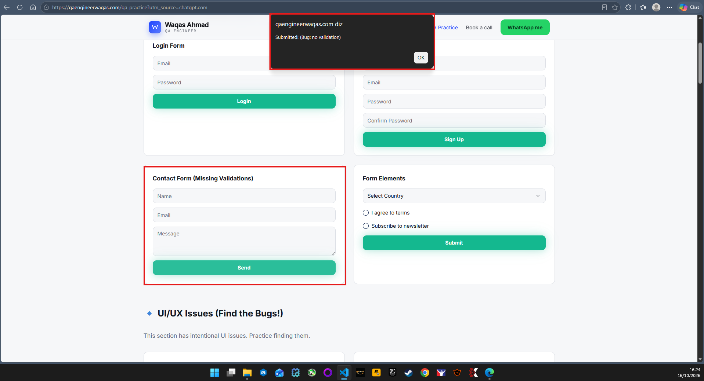

# Relatório de Defeitos — Web Quality Lab

## BUG-001 — Mensagem de sucesso exibida com e-mail inválido, sem confirmação de autenticação.

**Resumo:** A tela de login exibe a mensagem `Login successful!` independentemente dos dados informados nos campos de e-mail e senha.

**Ambiente:** QA Practice Website — https://qaengineerwaqas.com/qa-practice

**Pré-condição:** Estar na tela de login.

**Passos para reproduzir:**
1. Acessar a tela de login.
2. Informar diferentes combinações de e-mail e senha, incluindo dados em formatos inválidos e dados fictícios em formatos aparentemente válidos.
3. Clicar no botão de login em cada tentativa.
4. Observar a mensagem apresentada e o comportamento da tela.

**Resultado esperado:** A aplicação deve validar o formato do e-mail e não apresentar uma mensagem que indique sucesso no login quando o e-mail estiver em formato inválido. Para confirmar a autenticação, é necessário verificar o comportamento definido para as credenciais utilizadas.

**Resultado obtido:** Segundo os testes executados, a aplicação exibe `Login successful!` independentemente dos dados informados. Não ocorre redirecionamento nem abertura de uma área interna.

**Impacto potencial:** A mensagem pode induzir o usuário a acreditar que a autenticação foi realizada com sucesso, mesmo quando isso não foi demonstrado.

**Severidade:** A definir após investigação adicional.

**Prioridade:** A definir conforme o impacto confirmado.

**Status:** Comportamento suspeito — requer confirmação dos requisitos.

**Observação:** Foi confirmada a exibição da mensagem de sucesso com um e-mail em formato inválido. Não foi possível confirmar se a autenticação foi realizada. O registro se limita ao comportamento observado na interface.

**Evidência:**

**Observação:** A autenticação real não foi confirmada. O registro documenta apenas a mensagem exibida e o comportamento observado na interface.

## BUG-002 — Mensagem de envio exibida com campos vazios ou parcialmente preenchidos

**Resumo:** O formulário de contato exibe a mensagem `Submitted! (Bug: no validation)` independentemente do preenchimento dos campos.

**Ambiente:** QA Practice Website — https://qaengineerwaqas.com/qa-practice

**Pré-condição:** Estar na seção do formulário de contato.

**Cenários executados:**
- **CT-005:** Envio com todos os campos vazios.
- **CT-006:** Envio preenchendo somente os campos de nome e mensagem.
- **CT-007:** Envio com todos os campos preenchidos com dados fictícios em formato válido.

**Passos para reproduzir:**
1. Acessar o formulário de contato.
2. Preparar um dos cenários de preenchimento descritos acima.
3. Clicar no botão de envio.
4. Observar a mensagem apresentada.
5. Repetir o procedimento com os outros dois cenários.

**Resultado esperado:** Caso existam campos obrigatórios, a aplicação deve impedir o envio quando eles estiverem vazios ou incompletos e informar ao usuário o que precisa ser corrigido. Com os campos preenchidos corretamente, deve apresentar uma confirmação compatível com o resultado do envio.

**Resultado obtido:** Nos três cenários executados — todos os campos vazios (CT-005), preenchimento parcial (CT-006) e todos os campos preenchidos (CT-007) — a aplicação exibiu a mesma mensagem: `Submitted! (Bug: no validation)`.

**Impacto potencial:** O formulário pode aceitar tentativas de envio com dados obrigatórios ausentes e não diferenciar entradas completas de incompletas.

**Severidade:** A definir após verificar os requisitos e o comportamento esperado.

**Prioridade:** A definir.

**Status:** Comportamento reproduzido — validação em investigação.

**Observação:** A mensagem sugere ausência de validação, mas não comprova que os dados foram efetivamente enviados ou armazenados. Essa parte não foi verificada.

**Evidência:** 

